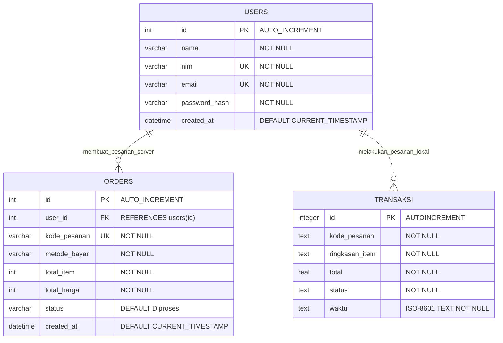

# ERD, Skema Basis Data & Desain UI — CerdasCanteen

Dokumentasi perancangan basis data, arsitektur penyimpanan lokal, dan desain UI/UX oleh **Anggota 2 (Athallah Rizky Erin Saputra — UI/UX & Data)** untuk Kelompok 1 Sistem Informasi UNTAN.

---

## 1. Entity Relationship Diagram (ERD)



> **Diagram Interaktif (FigJam):** [CerdasCanteen — ERD Database (MySQL & SQLite)](https://www.figma.com/board/gQ6nS3nAlDTwZWwy1rjSyG)

---

## 2. DDL Skema Basis Data

### a. MySQL Server — Tabel `users` (Autentikasi Mahasiswa)
*(Tersedia juga bersama tabel `orders` pada [`backend/database.sql`](../backend/database.sql))*

```sql
CREATE TABLE users (
  id INT AUTO_INCREMENT PRIMARY KEY,
  nama VARCHAR(100) NOT NULL,
  nim VARCHAR(30) NOT NULL UNIQUE,
  email VARCHAR(120) NOT NULL UNIQUE,
  password_hash VARCHAR(255) NOT NULL,
  created_at DATETIME NOT NULL DEFAULT CURRENT_TIMESTAMP
) ENGINE=InnoDB DEFAULT CHARSET=utf8mb4;
```

### b. SQLite Lokal Perangkat — Tabel `transaksi` (Riwayat Offline)
*(Diimplementasikan otomatis pada [`lib/services/db_helper.dart`](../lib/services/db_helper.dart) menggunakan `sqflite` + `path`)*

```sql
CREATE TABLE transaksi (
  id INTEGER PRIMARY KEY AUTOINCREMENT,
  kode_pesanan TEXT NOT NULL,
  ringkasan_item TEXT NOT NULL,
  total REAL NOT NULL,
  status TEXT NOT NULL,
  waktu TEXT NOT NULL
);
```

---

## 3. Penjelasan Relasi Logis (3 Kalimat)

Tabel `users` disimpan pada server MySQL untuk mengelola identitas dan autentikasi akun mahasiswa secara terpusat, sedangkan tabel `transaksi` disimpan pada SQLite lokal di perangkat pengguna agar riwayat pesanan kantin tetap dapat diakses dengan cepat meskipun dalam kondisi offline. Secara konseptual keduanya memiliki relasi *one-to-many* (1:N) karena satu mahasiswa (`users`) dapat menghasilkan banyak catatan pesanan (`transaksi`), namun tidak memakai *foreign key* fisik sebab keduanya berada pada dua sistem basis data yang terpisah. Keterkaitan keduanya dijaga secara logis di lapisan aplikasi melalui sesi login aktif (`userId`/`token` pada `SharedPreferences` dan `AuthProvider`), di mana setiap checkout yang berhasil dilakukan pengguna terautentikasi langsung direkam ke SQLite melalui `DbHelper.insertTransaksi()`.

---

## 4. Lapisan Data Non-Relasional di CerdasCanteen

Selain tabel MySQL dan SQLite di atas, komponen data lain pada aplikasi dikelola sesuai sifat kebutuhannya:

| Lapisan Data | Implementasi | Kegunaan |
| :--- | :--- | :--- |
| **REST API Eksternal** | `lib/services/api_service.dart` (TheMealDB API) | Mengambil katalog `>= 10` menu unik secara *real-time* (tanpa API key) dengan harga simulasi deterministik `Rp8.000–Rp35.000` (kelipatan `500`), timeout 10 detik, serta penanganan error offline/timeout. |
| **State Memori (RAM)** | `lib/providers/cart_provider.dart` (`Provider`) | Menyimpan daftar item keranjang (`List<CartItem>`), kalkulasi total harga, dan estimasi waktu tunggu sebelum checkout. |
| **Key-Value Lokal** | `lib/services/prefs_service.dart` (`SharedPreferences`) | Menyimpan preferensi pengguna secara permanen: `isDarkMode`, `namaPanggilan`, `notifikasiAktif`, `kategoriTerakhir`, serta sesi `token` dan `userId`. |

---

## 5. Sistem Desain, Tipografi & Aksesibilitas (WCAG 2.1)

- **Font:** **Plus Jakarta Sans** (`google_fonts`) — 7 *weights* (`200–800` + Italic), *x-height* tinggi untuk keterbacaan harga pada layar sempit, penskalaan presisi lintas perangkat, dan ramah aksesibilitas.
- **Palet Warna & Rasio Kontras:**
  - Light Primary `#007F5F` (Deep Emerald) vs `#FFFFFF`: **5.00 : 1** *(WCAG AA — teks normal)*
  - Light Secondary `#2B9348` (Forest Green) vs `#FFFFFF`: **3.91 : 1** *(WCAG AA — Large/UI)*
  - Header Brand `#55A630` (Leaf Green) vs `#FFFFFF`: **3.05 : 1** *(WCAG AA — Large Bold AppBar)*
  - Dark Primary `#80B918` (Apple Lime) vs `#0D1B12`: **7.50 : 1** *(WCAG AAA)*
  - Dark Price Accent `#AACC00` (Citrus Lime) vs `#1A271F`: **8.38 : 1** *(WCAG AAA)*

### Tautan Aset Desain & Presentasi
- **Wireframe & UI Design (7 Layar + Dark Mode):** [Figma UI Design — CerdasCanteen](https://www.figma.com/design/wauJbVqA5AZxOpl2voKQMK)
- **Diagram ERD & Arsitektur Data:** [FigJam — ERD Database CerdasCanteen](https://www.figma.com/board/gQ6nS3nAlDTwZWwy1rjSyG)
- **Slide Presentasi UAS (5 Menit):** [Figma Slides — Presentasi CerdasCanteen](https://www.figma.com/slides/dD1vu8tcvt7XDZ5tudHXKH)
